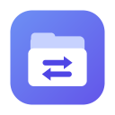
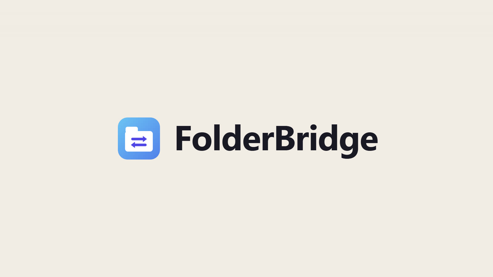

<p align="center"></p>

<h1 align="center">FolderBridge</h1>

<p align="center"><b>Save on your Mac. Open on your PC.</b> And the other way around.<br>
Free, open-source folder sync over your home Wi-Fi - one folder, identical on both computers. No cloud, no account, no storage limit.</p>

<p align="center">
  <a href="https://aiworldbyshachar.github.io/folderbridge/">Website &amp; demo video</a> ·
  <a href="https://github.com/aiworldbyshachar/folderbridge/releases/latest/download/FolderBridge-Windows-Setup.exe">Download for Windows</a> ·
  <a href="https://github.com/aiworldbyshachar/folderbridge/releases/latest/download/FolderBridge-macOS.dmg">Download for Mac</a> ·
  <a href="README.he.md">עברית</a>
</p>

<p align="center"><a href="https://aiworldbyshachar.github.io/folderbridge/#demo"></a></p>

---

If you work with a Mac and a PC on the same desk, you know the ritual for moving files between them: hunt for a USB stick, email yourself an attachment that turns out to be too big, or upload to a cloud drive and wait for it to come back down. FolderBridge gives both computers one shared folder instead.

- **Save here, open there.** Put a file in the `FolderBridge` folder on one computer and it's on the other a moment later. Edits, renames, new folders and deletions travel too.
- **Nothing is ever lost.** Deleted and replaced files go to FolderBridge's own trash for 30 days, with Restore. If many files disappear at once, it asks before deleting them on the other computer. A folder that goes missing (an unplugged drive) is never taken as "everything was deleted".
- **Changed on both? You choose.** If the same file was edited on both computers before they could sync, both versions are kept safe until you pick one - or keep both. You can also set it to always keep both copies, or to let the newest win.
- **Big files are fine.** Videos and photo folders of any size travel directly over your network, in pieces that are checked on arrival and carry on after an interruption.
- **Mac and Windows names.** Hebrew and accented names arrive exactly right. Names Windows can't use (like `notes?.txt`) are pointed out so you can rename them - nothing is renamed behind your back.
- **Private.** No account, no server, no cloud - the computers talk directly on your network, encrypted with AES-256-GCM using a key derived from your connection code. Pause sync with one click.
- **Six languages.** English (default), Hebrew, Spanish, French, Russian and Arabic, with right-to-left layouts for Hebrew and Arabic.
- **Free and open source** under the MIT licence.

> **The one rule:** both computers must be on the **same local network** - the same Wi-Fi (or the same router, wired). FolderBridge never relays anything over the internet. Changes made while a computer is away are kept and sync when it's back.

## Install

| | |
|---|---|
| **Windows 10/11** | Download [`FolderBridge-Windows-Setup.exe`](https://github.com/aiworldbyshachar/folderbridge/releases/latest/download/FolderBridge-Windows-Setup.exe) and run it. If SmartScreen says "Windows protected your PC", click **More info → Run anyway**. When the firewall asks, click **Allow access** and make sure your home network is set to **Private**. |
| **macOS 12+** (Apple Silicon & Intel) | Download [`FolderBridge-macOS.dmg`](https://github.com/aiworldbyshachar/folderbridge/releases/latest/download/FolderBridge-macOS.dmg), open it and drag FolderBridge to Applications. On first launch, if macOS can't verify the app, go to **System Settings → Privacy & Security → Open Anyway**. Allow it to find devices on your local network. If macOS says the app is "damaged", run `xattr -cr /Applications/FolderBridge.app` once in Terminal. |

The apps aren't signed with paid Apple/Microsoft developer certificates - that's why both systems ask once. You can also [build from source](#build-from-source).

## Connect your computers (once)

1. Open FolderBridge on the first computer → **Settings** (the icon at the top). Under **Connect your computers** you'll see a code like `K7QM-4XRT-P9WE`.
2. On the second computer: **Settings → Code from another computer** → type the code → **Apply**.
3. Within a few seconds the top of the window says **Connected to …**. Done.

If they don't find each other, see **Settings → Other computer not showing up?** - you can also add the other computer by its IP address (shown in its own settings).

## Use it

- Each computer has a `FolderBridge` folder in its home folder (`~/FolderBridge` on the Mac, `C:\Users\<you>\FolderBridge` on Windows). Use it like any folder, from Finder, File Explorer or any app. You can pick a different folder in Settings.
- **The window** (click the tray / menu-bar icon) shows whether everything is up to date, what's on its way, and every recent change: what, on which computer, when. Search by name, filter by computer, and open any file's folder.
- **Trash:** the bin icon at the top of the window. Restore puts a file back on every computer.
- **When a file changed on both computers:** Settings → choose *Ask me every time* (default), *Keep both copies* or *Newest wins*. The choice applies to all your computers.
- **Pause sync:** from the tray menu or Settings. Changes made meanwhile are sent when you resume.
- **Launch at login**, **language** and an optional **keyboard shortcut** to open the window: Settings.

## Where your data lives

| | Windows | macOS |
|---|---|---|
| Your files | `C:\Users\<you>\FolderBridge` | `~/FolderBridge` |
| FolderBridge's trash | `.folderbridge\trash` inside that folder | `.folderbridge/trash` inside that folder |
| Settings, index, log | `%APPDATA%\FolderBridge` | `~/Library/Application Support/FolderBridge` |

Uninstalling keeps your files and FolderBridge's data.

## Troubleshooting

- **Always "Looking for your other computer…"** - both computers on the same network (not a guest network)? FolderBridge open on both? On Windows, the firewall must allow FolderBridge on Private networks; on Mac, **System Settings → Privacy & Security → Local Network → FolderBridge** must be on.
- **"Found … with a different connection code"** - enter one computer's code on the other.
- **Routers that block discovery** (common with mesh Wi-Fi) - add the other computer by IP in Settings. FolderBridge uses TCP port 47811 and UDP port 47810 (ClipBridge uses 47801/47800, so both can run side by side).
- **A VPN** on either computer can block local-network traffic.
- **Something else?** Settings → Advanced → Open data folder → `folderbridge.log`, and [open an issue](https://github.com/aiworldbyshachar/folderbridge/issues).

## How it works

- `src/main/watcher.js` notices changes in the folder (file system events, plus a full check every few minutes in case an event was missed) and waits until a file has stopped changing before it's sent.
- `src/main/index.js` keeps one record per file: size, time, sha256 and a version vector, so each computer can tell whether the other's version already includes its own or whether both changed it (a conflict). Deletions are kept as records too, so they travel.
- `src/main/sync.js` - computers find each other with UDP broadcast and talk over HTTP, every message sealed with AES-256-GCM. Changes arrive two ways at once: pushed by the computer that made them, and through a long-poll each computer keeps open to the other - so it works even if only one side can accept connections.
- `src/main/transfer.js` sends file content in sealed 1 MB frames into a `.part` file that resumes after an interruption; the whole file's sha256 is checked before it replaces anything.
- `src/main/folder.js` applies the changes: renames as renames, the old version to the trash, conflicts by the chosen rule, the mass-delete check, Windows name rules. `src/main/main.js` is the tray, window and IPC; the UI is in `src/renderer`, all strings in all languages in `src/shared/i18n.js`.

## Build from source

```bash
npm install
npm start            # run from source
npm test             # engine, sync and translation tests
npm run dist:win     # Windows installer → dist/
npm run dist:mac     # macOS app → dist/ (on a Mac)
```

On a Mac, `bash scripts/build-mac.sh` builds the app and installs it into `/Applications` in one step. `node dev/cli.js --folder <path>` runs the sync engine without the app window, and `node dev/serve.js` previews the window in a browser with sample data.

Releases are built by GitHub Actions: pushing a tag like `v1.0.0` builds both installers and publishes them (`.github/workflows/release.yml`).

### The demo video

The film on the website is code too: [`video/`](video) is a [HyperFrames](https://hyperframes.heygen.com) project (HTML + GSAP rendered to MP4), with narration, music and sound effects from ElevenLabs. Its UI is rebuilt from the app's own stylesheet and translations (`video/tools/make-languages.mjs` writes the six-language scene from `src/shared/i18n.js`). To regenerate the audio you need your own ElevenLabs key in `.env` (`ELEVENLABS_API_KEY=…`, never committed); see `video/tools/elevenlabs.mjs`. The UI font is Segoe UI loaded from the system, so renders are made on Windows.

## Contributing

Issues and pull requests are welcome. Good first ideas: several synced folders, more languages (add a table to `src/shared/i18n.js`), Linux support.

## More free tools

- [ClipBridge](https://github.com/aiworldbyshachar/clipbridge) - copy on your Mac, paste on your PC, with one shared clipboard history.
- [KeyBridge](https://github.com/aiworldbyshachar/keybridge) - press it once, it's typed: text shortcuts and hotkeys with left and right modifier keys, on every computer you sign in to.

## Licence

[MIT](LICENSE) - free to use, change and share.
